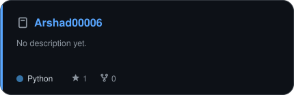
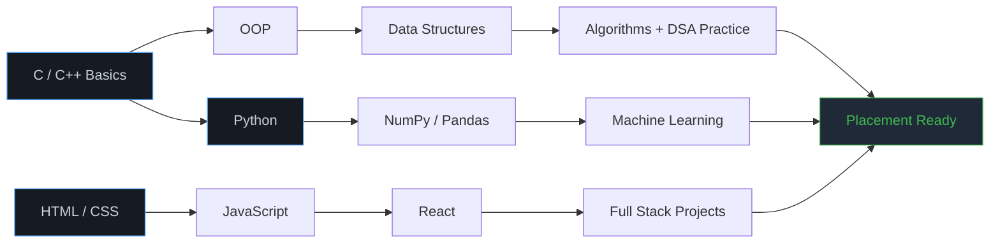

  

  

## 👋 About Me

I'm a Computer Science student specialising in **AI and Data Science**. Right now I'm focused on getting the fundamentals solid: data structures, clean code, and building things that actually work instead of just collecting tutorials.

<b>📌 Beyond the code</b>

 

| | |
|:--|:--|
| 🎯 **2026 goal** | 100+ DSA problems · 3 shipped projects · 1 internship |
| 📚 **Learning from** | GeeksforGeeks · W3Schools|
| 🧠 **Curious about** | Machine Learning · Computer Vision · System Design |
| 🎮 **Off-screen** | Watching Movies and Series · Listening Music |
| 💬 **Believe in** | Consistency over intensity. Every single time. |

## 🛠️ Tech Stack

<b>📊 Where I actually stand (honest self-assessment)</b>

 

| Area | Stack | Confidence |
|:---|:---|:---|
| **Core Programming** | C · C++ · Python | `███░░░░░░░░░` Starting |
| **Web Basics** | HTML · CSS · JavaScript | `███░░░░░░░░░` Starting |
| **DSA** | Arrays · Strings · Recursion · Sorting | `██████░░░░░░` In progress |
| **Database** | MySQL | `██████░░░░░░` Fundamentals |
| **Version Control** | Git · GitHub | `████████░░░░` Daily use |
| **Next Up** | React · Node.js · Pandas | `███░░░░░░░░░` Starting |

## 📊 GitHub Statistics

  

### 📈 Contribution Activity

### 🧭 Activity Overview

### 🏆 Achievements

## 🐍 Contribution Snake

<picture>
  <source media="(prefers-color-scheme: dark)" srcset="https://raw.githubusercontent.com/Arshad00006/Arshad00006/output/github-contribution-grid-snake-dark.svg"/>
  <source media="(prefers-color-scheme: light)" srcset="https://raw.githubusercontent.com/Arshad00006/Arshad00006/output/github-contribution-grid-snake.svg"/>
  
</picture>

## 🚀 Featured Projects

 

| Project | What It Solves | Stack | Links |
|:---|:---|:---|:---|
| **INFRAGuard AI** | Predict Infrastructure Project Risks Before They Become Overruns | `Python` `Pandas` `Scikit-learn` `CatBoost` `SHAP` `Streamlit` `Plotly` `CSV / SQLit` | [Live](https://infraguard-ai.vercel.app/) |
| **TIMMY** | A plot-first design assistant that turns irregular land into a sustainable building concept: sun, water, soil, materials and cost | `React + Vite frontend` `Python FastAPI + Shapely geometry` `pvlib sun path` `Three.js 3D preview` | [Demo](https://timmy-three-gilt.vercel.app/) |

## 💻 Competitive Programming

  

## 🗺️ My Roadmap

## 🎓 Education

<table>
  <tr>
    <td width="60" align="center">🎓</td>
    <td><b>B.Tech in Computer Science (AI & Data Science)</b> 
    SISTec Gandhi Nagar · 2025 to 2026 </td>
  </tr>
  <tr>
    <td align="center">🏫</td>
    <td><b>Higher Secondary, Science (PCM)</b> 
    DAV Public School Koyla Nagar · 2024</td>
  </tr>
</table>

## 🤝 Let's Connect

  

**💙 *"Every expert was once a beginner. Keep building, keep learning."***

⭐ If something here helped you, a star on the repo genuinely makes my day.

  

