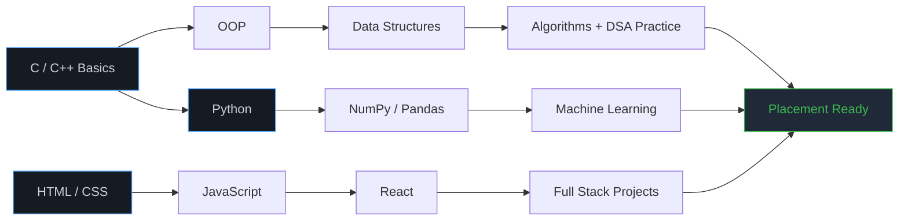

<!--
═══════════════════════════════════════════════════════════════════════
  MD ARSHAD RAZA — GitHub Profile README
  • Replace every [ BRACKETED ] placeholder before publishing.
  • header.svg and tech-stack.svg live in this repo — they never break.
  • If a stats card goes blank, see SETUP.md → "Fixing broken cards".
═══════════════════════════════════════════════════════════════════════
-->

<p align="center">
  
</p>

<div align="center">


<br><br>


<a href="https://github.com/Arshad00006?tab=followers"></a>
<a href="https://github.com/Arshad00006?tab=repositories"></a>

</div>


## 👋 About Me

I'm a Computer Science undergrad specialising in **AI & Data Science**, currently focused on getting genuinely good at fundamentals — data structures, clean code, and shipping things that actually work rather than collecting tutorials.

```yaml
Name:        MD Arshad Raza
Role:        B.Tech CSE - AI & Data Science
College:     Sagar Institute of Science and Technology
Graduating:  2029
Location:    India 🇮🇳

Focused on:
  - Data Structures & Algorithms in C++
  - Frontend fundamentals → React
  - Python for Machine Learning

Building:    "[ YOUR CURRENT PROJECT ]"
Open to:     [internships, open source, team projects]
Reach me:    "[ your.email@gmail.com ]"
```

<details>
<summary><b>📌 Beyond the code</b></summary>

<br>

| | |
|:--|:--|
| 🎯 **2026 goal** | 300+ DSA problems · 3 shipped projects · 1 internship |
| 📚 **Learning from** | [ course / book you're on ] |
| 🧠 **Curious about** | Machine Learning · Computer Vision · System Design |
| 🎮 **Off-screen** | [ hobby ] · [ hobby ] |
| 💬 **Believe in** | Consistency over intensity. Every single time. |

</details>


## 🛠️ Tech Stack

<div align="center">



</div>

<details>
<summary><b>📊 Where I actually stand (honest self-assessment)</b></summary>

<br>

<div align="center">

| Area | Stack | Confidence |
|:---|:---|:---|
| **Core Programming** | C · C++ · Python | `██████████░░` Intermediate |
| **Web Basics** | HTML · CSS · JavaScript | `████████░░░░` Comfortable |
| **DSA** | Arrays · Strings · Recursion · Sorting | `██████░░░░░░` In progress |
| **Database** | MySQL | `██████░░░░░░` Fundamentals |
| **Version Control** | Git · GitHub | `████████░░░░` Daily use |
| **Next Up** | React · Node.js · Pandas | `███░░░░░░░░░` Starting |

</div>

</details>


## 📊 GitHub Statistics

<!--
  If any card below renders blank, the shared public server is rate-limited.
  Deploy your own instance (5 min, free) and replace the domain.
  Full instructions: SETUP.md → "Fixing broken cards"
-->

<div align="center">


<br><br>


</div>

### 📈 Contribution Activity

<div align="center">


<br>

<!-- Lightweight backup chart — different provider, so it rarely fails at the same time -->


</div>

### 🧭 Activity Overview

<!-- Self-hosted: refreshed every 12h by .github/workflows/activity-radar.yml -->
<div align="center">



</div>

### 🏆 Achievements

<div align="center">


</div>

<details>
<summary><b>📇 Detailed breakdown</b></summary>

<br>

<div align="center">


</div>

</details>


## 🐍 Contribution Snake

<div align="center">

<picture>
  <source media="(prefers-color-scheme: dark)" srcset="https://raw.githubusercontent.com/Arshad00006/Arshad00006/output/github-contribution-grid-snake-dark.svg"/>
  <source media="(prefers-color-scheme: light)" srcset="https://raw.githubusercontent.com/Arshad00006/Arshad00006/output/github-contribution-grid-snake.svg"/>
  
</picture>

</div>


## 🚀 Featured Projects

<div align="center">

<!-- Replace [ REPO_NAME ] with real repo names. Delete any card you don't have yet. -->
<a href="https://github.com/Arshad00006/[ REPO_NAME ]">
  
</a>
<a href="https://github.com/Arshad00006/[ REPO_NAME_2 ]">
  
</a>

</div>

<br>

| Project | What It Solves | Stack | Links |
|:---|:---|:---|:---|
| **[ Project Name ]** | The actual problem it solves, in one line | `C++` `MySQL` | [Code](#) · [Demo](#) |
| **[ Project Name ]** | The actual problem it solves, in one line | `HTML` `CSS` `JS` | [Code](#) · [Live](#) |
| **[ Project Name ]** | The actual problem it solves, in one line | `Python` `scikit-learn` | [Code](#) |


## 💻 Competitive Programming

<div align="center">

<a href="https://leetcode.com/u/[ LEETCODE_USERNAME ]/"></a>
<a href="https://www.geeksforgeeks.org/user/[ GFG_USERNAME ]/"></a>
<a href="https://www.hackerrank.com/profile/[ HACKERRANK_USERNAME ]"></a>
<a href="https://www.codechef.com/users/[ CODECHEF_USERNAME ]"></a>

<br><br>


</div>


## 🗺️ My Roadmap




## 🎓 Education & Certifications

<table>
  <tr>
    <td width="60" align="center">🎓</td>
    <td><b>B.Tech — Computer Science (AI & Data Science)</b><br/>
    <sub>[ YOUR UNIVERSITY NAME ] · [ 20XX ] – [ 20XX ] · CGPA: [ X.XX ]</sub></td>
  </tr>
  <tr>
    <td align="center">🏫</td>
    <td><b>Higher Secondary — Science (PCM)</b><br/>
    <sub>[ YOUR SCHOOL NAME ] · [ 20XX ]</sub></td>
  </tr>
  <tr>
    <td align="center">📜</td>
    <td><b>[ Certification Name ]</b><br/>
    <sub>[ Issuer ] · [ Month 20XX ] · <a href="#">Credential</a></sub></td>
  </tr>
</table>


## 💡 Quote of the Day

<div align="center">


</div>


## 🤝 Let's Connect

<div align="center">

<a href="https://linkedin.com/in/[ YOUR_LINKEDIN ]"></a>
<a href="mailto:[ your.email@gmail.com ]"></a>
<a href="https://x.com/[ YOUR_X_HANDLE ]"></a>
<a href="https://instagram.com/[ YOUR_INSTAGRAM ]"></a>
<a href="[ LINK_TO_YOUR_RESUME_PDF ]"></a>

<br><br>

**💙 *"Every expert was once a beginner. Keep building, keep learning."***

<sub>⭐ If something here helped you, a star on the repo genuinely makes my day.</sub>

</div>

<p align="center">
  
</p>
